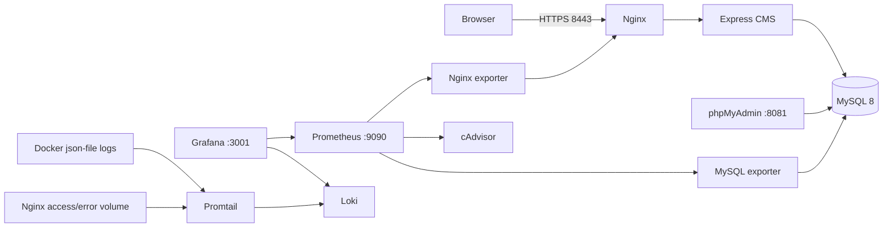

# Hệ thống Blog / CMS — Đề tài 07

Dự án thực hành môn **Triển khai và Quản trị Hệ thống Phần mềm**: Express + EJS, MySQL 8.0, phpMyAdmin, Nginx HTTPS, Prometheus, Grafana, cAdvisor, Nginx/MySQL exporters, Loki và Promtail. Toàn bộ dịch vụ chạy bằng Docker Compose.

## 1. Kiến trúc



| Mạng | Dịch vụ | Mục đích |
|---|---|---|
| `frontend_net` | nginx, app, phpmyadmin, nginx-exporter | Reverse proxy và thu thập stub_status |
| `backend_net` (internal) | app, mysql, phpmyadmin, mysqld-exporter | DB cô lập, không có cổng 3306 trên host |
| `monitoring_net` | exporters, cadvisor, prometheus, grafana, loki, promtail | Metrics và log |

Nginx chỉ tham gia frontend; MySQL chỉ tham gia backend. phpMyAdmin nối thêm frontend để Docker có thể publish UI trên loopback khi backend là mạng internal. App là cầu nối ở tầng ứng dụng, exporter nối mạng cần giám sát với monitoring. Mạng Docker không thay thế phân quyền dịch vụ: thành viên cùng mạng vẫn có thể kết nối nhau. Các cổng quản trị/app bind `127.0.0.1`; riêng cAdvisor dùng `8082:8080` theo cấu hình demo, publish trên mọi interface của host.

## 2. Cấu trúc thư mục

```text
.
├── app/
│   ├── Dockerfile
│   ├── package.json / package-lock.json
│   ├── src/server.js
│   ├── views/                 # EJS: blog, đăng nhập, danh sách, biểu mẫu
│   └── public/style.css
├── db/
│   ├── init.sql              # Schema + dữ liệu mẫu
│   ├── 01-users.sh           # Giới hạn quyền app và tạo exporter user
│   └── 02-admin.sql          # Tài khoản MySQL admin/123456 toàn quyền
├── nginx/
│   ├── nginx.conf
│   ├── generate-ssl.sh
│   └── ssl/                  # Chứng chỉ/key tự sinh, Git bỏ qua
├── monitoring/
│   ├── prometheus.yml
│   └── grafana/
│       ├── provisioning/datasources/ # prometheus.yml + loki.yml
│       ├── provisioning/dashboards/dashboards.yml
│       └── dashboards/             # blog-cms.json + blog-logs.json
├── logging/
│   ├── loki-config.yaml
│   └── promtail-config.yaml
├── scripts/
│   ├── setup.ps1 / setup.sh
│   ├── smoke.ps1
│   ├── check-views.js
│   ├── integration.js
│   └── check-observability.js
├── milestones/                # Compose snapshot cho commit 1 và 2
├── docker-compose.yml
├── .env.example
└── README.md
```

## 3. Chuẩn bị máy

- Docker Engine trên Linux hoặc Docker Desktop **Linux containers**, Compose v2 trở lên. Windows: bật WSL2 và Docker Desktop integration. CLI đơn lẻ chưa đủ; `docker info` phải trả thông tin server.
- Gợi ý tài nguyên: 4 CPU, RAM 6–8 GB, dung lượng trống 10 GB; có Internet tải images và npm packages khi build lần đầu.
- Các cổng 80, 8443, 8081, 8082, 9090, 3001 chưa bị chiếm.
- Linux cần `/sys`, `/var/lib/docker`, `/dev/kmsg` để cAdvisor lấy đủ metrics. Docker Desktop chỉ quan sát Linux VM/container, không đo trực tiếp toàn bộ Windows host. Không hỗ trợ Windows containers hoặc rootless Docker cho cấu hình cAdvisor hiện tại.
- Images được gắn tag cụ thể, không dùng `latest`. Khi nâng phiên bản, kiểm tra lại cấu hình, khả năng tương thích Docker API và lỗ hổng. Có thể pin digest sau khi pull trên nền tảng thực tế.

Kiểm tra:

```powershell
docker version
docker compose version
docker info
```

## 4. Khởi chạy từng bước

### Bước 1 — Tạo mật khẩu

PowerShell, tại thư mục dự án:

```powershell
powershell -ExecutionPolicy Bypass -File ./scripts/setup.ps1
```

Linux/macOS (cần OpenSSL trên host cho bước tạo `.env`):

```sh
sh scripts/setup.sh
```

Script tạo `.env` với mật khẩu app/DB/exporter ngẫu nhiên 48 ký tự hex và session secret 64 ký tự; CMS dùng admin@email.com/123456 và Grafana dùng admin/admin theo cấu hình demo; không ghi đè `.env` đang tồn tại. Xem `.env` bằng trình soạn thảo để lấy mật khẩu. `.env.example` chỉ là mẫu, **không chạy hệ thống bằng các giá trị ReplaceWith...**. Không gửi `.env` lên GitHub hoặc chụp vào báo cáo. Trên Windows, giới hạn ACL file cho tài khoản cá nhân; trên Linux script đặt quyền 600.

Nếu tự điền `.env`: mật khẩu bootstrap admin tối thiểu 6 ký tự (tối đa 72 byte UTF-8); tài khoản demo là admin@email.com / 123456, session secret tối thiểu 32; dùng mật khẩu khác nhau. `MYSQL_USER` và `MYSQL_DATABASE` chỉ dùng chữ/số/underscore; mật khẩu exporter chỉ dùng chữ/số để init SQL an toàn. Không sửa tên user/database sau khi volume đã được khởi tạo mà chưa lập kế hoạch migration.

### Bước 2 — Kiểm tra, tải và chạy

```powershell
docker compose config --quiet
docker compose pull
docker compose up -d --build
docker compose ps -a
docker compose logs --tail=100 app mysql nginx
```

`ssl-init` kết thúc với exit code 0 là bình thường. Nó tạo RSA 3072-bit certificate cho `localhost` và `127.0.0.1` trong `nginx/ssl`, hiệu lực 365 ngày. Script có thể chạy trong container nên không cần OpenSSL cài trên Windows. Compose đợi DB healthy → app healthy → Nginx; exporter đợi dịch vụ tương ứng.

Lần đầu cần vài phút để MySQL init và images tải xong. `init.sql` chỉ chạy khi `mysql_data` rỗng. Sau đó script tạo user exporter, thu hồi quyền mặc định của app và cấp lại SELECT/INSERT/UPDATE/DELETE. App tạo admin từ `.env` khi DB chưa có admin. Các lần restart không ghi đè tài khoản hoặc mật khẩu đã chỉnh bằng CMS.

### Bước 3 — Mở website

Mở **https://localhost:8443** và chấp nhận chứng chỉ tự ký trong môi trường thực hành. HTTP tại `http://localhost` chuyển hướng sang HTTPS. Chỉ đăng nhập bằng HTTPS vì session cookie đặt `Secure`.

```powershell
curl.exe -k -I https://localhost:8443
curl.exe -k https://localhost:8443/healthz
powershell -ExecutionPolicy Bypass -File ./scripts/smoke.ps1
node scripts/integration.js
```

`integration.js` tạo dữ liệu có prefix `e2e-`, kiểm tra đầy đủ CRUD, login/role/CSRF/XSS rồi xóa dữ liệu đó khi thành công. Script dùng admin từ `.env`; nếu bạn đã đổi mật khẩu qua CMS, cập nhật `.env` tương ứng trước khi kiểm thử. Nó chỉ bỏ xác minh chứng chỉ khi kết nối localhost trong lab. `check-views.js` có thể chạy sau `npm ci --prefix app` để render 18 trường hợp không cần DB.

`-k` chỉ dành cho kiểm tra chứng chỉ tự ký trong lab. Chứng chỉ production cần CA đáng tin cậy; khi triển khai domain khác, thay SAN/certificate, `server_name` và URL redirect.

### Bước 4 — Kiểm tra giám sát và log

1. Truy cập Prometheus → **Status → Target health**: sáu job phải `UP`. Thử `nginx_up`, `mysql_up`, `container_memory_working_set_bytes`.
2. Truy cập Grafana → **Dashboards → Blog CMS → Blog CMS Overview**. Prometheus và Loki datasource đã provision tự động; không phải nhập URL thủ công.
3. Grafana → **Explore → Loki** → chạy `{job="docker"}` và `{job="nginx-files"}`. Chọn thời gian Last 15 minutes, refresh sau 15–30 giây.
4. Sau `node scripts/integration.js`, chờ khoảng 30 giây rồi chạy `node scripts/check-observability.js` để xác minh targets, metrics, datasource, dashboards và cả ba LogQL.
5. Truy cập một URL không tồn tại như `https://localhost:8443/khong-ton-tai` để tạo HTTP 404, rồi chạy query số 2 bên dưới.

## 5. Cổng và tài khoản demo

| Thành phần | Địa chỉ trên máy host | Đăng nhập |
|---|---|---|
| Blog công khai | https://localhost:8443 | Không cần |
| CMS quản trị | https://localhost:8443/login | `ADMIN_EMAIL` (mặc định admin@email.com) / `ADMIN_PASSWORD` trong `.env` |
| phpMyAdmin | http://localhost:8081 | `admin` / `123456` (toàn quyền), hoặc blogapp / MYSQL_PASSWORD; server cố định mysql |
| Grafana | http://localhost:3001 | `admin` / `admin` |
| Prometheus | http://localhost:9090 | Không có auth, chỉ bind loopback |
| HTTP redirect | http://localhost:80 | Chuyển hướng HTTPS |
| cAdvisor | http://localhost:8082 | Không có auth |
| Loki | http://127.0.0.1:3100/ready | Health/API, chỉ bind loopback; không có trang chủ UI |
| MySQL / exporters / app | Không publish | Chỉ truy cập nội bộ Docker |

`editor@example.com` là tác giả dữ liệu mẫu, tài khoản ban đầu bị khóa bằng password hash không sử dụng được. Admin có thể đặt mật khẩu và dùng nó để demo vai trò `reader`: xem bài công khai, không có quyền quản trị. Theo yêu cầu demo, MySQL có tài khoản quản trị admin/123456 (ALL PRIVILEGES trên *.* WITH GRANT OPTION), Grafana dùng admin/admin. CMS vẫn dùng tài khoản DB blogapp hạn chế quyền và mật khẩu riêng. Root MySQL chỉ dùng cho bootstrap/bảo trì; không nhập root vào app/phpMyAdmin trong demo thường ngày.

## 6. Demo đầy đủ CRUD

1. Đăng nhập admin → **Danh mục → Thêm mới**, nhập tên và mô tả.
2. **Người dùng → Thêm mới**, đặt tên, email, vai trò reader/admin và mật khẩu tối thiểu 16 ký tự.
3. **Bài viết → Thêm mới**, chọn danh mục, tác giả, nhập nội dung, trạng thái draft. Bản nháp không xuất hiện ở trang công khai.
4. Chọn **Xem / Sửa**, đổi thành published, kiểm tra trên trang chủ và trang chi tiết.
5. Sửa tên danh mục, email người dùng, nội dung bài viết rồi tải lại danh sách để xác nhận.
6. Xóa bài viết demo trước, sau đó xóa danh mục và tác giả demo. Khóa ngoại ngăn xóa danh mục/tác giả còn bài viết; không được xóa chính mình hoặc làm mất admin cuối cùng.
7. Đăng xuất, thử truy cập `/admin/posts`: phải chuyển về login. Với reader, nhận 403.

App dùng SQL prepared statements, allowlist tên bảng/cột, server-side validation, EJS escape HTML, CSRF token cho mọi POST, session lưu trong DB, cookie HttpOnly/Secure/SameSite, chống login brute force theo IP và regenerate session khi login. Không hỗ trợ nhập HTML tùy ý vào bài viết: nội dung được hiển thị dạng văn bản để tránh stored XSS. Đây là CMS thực hành, chưa có upload, phân trang, reset password hoặc HA.

## 7. Ba truy vấn LogQL cho báo cáo

### Query 1 — Lọc lỗi ứng dụng hoặc MySQL

```logql
{job="docker", service=~"app|mysql"} |~ "(?i)(error|exception|fatal|critical)"
```

Tìm từ khóa lỗi trong stdout/stderr của app hoặc DB. App ghi JSON với `level=error`. Muốn lọc riêng app có thể dùng `{job="docker",service="app"} | json | level="error"`. Kết quả rỗng có thể do chưa có lỗi trong khoảng thời gian chọn.

### Query 2 — Request HTTP 4xx/5xx của Nginx

```logql
{job="nginx-files", stream="access"} | json | __error__="" | status >= 400
```

Access log được cấu hình JSON nên có thể lọc số `status`. Tạo request 404 để có minh chứng. Log error file xem bằng `{job="nginx-files",stream="error"}`; file error không phải JSON.

### Query 3 — Số dòng log theo container trong 5 phút

```logql
sum by (container) (count_over_time({job="docker", container=~".+"}[5m]))
```

Trong Explore chọn loại hiển thị time series hoặc table. Chỉ tính job docker để tránh đếm lặp log file Nginx. Promtail đọc json-file logs từ thư mục container trên Linux Docker host, gắn nhãn container bằng ID và nhãn service/project từ log attrs. Các container ngoài dự án cũng được thu nếu dùng json-file driver ở cùng Docker data root; chúng có thể không có nhãn service. Dự án đặt json-file rõ ràng cho mọi service. MySQL mặc định error log ra stderr; cấu hình này không bật general query log (tránh lộ dữ liệu và tăng tải).

## 8. Dashboard và PromQL

Hai dashboard provision sẵn: Blog CMS Overview gồm sức khỏe targets, trạng thái Nginx/MySQL, HTTP requests/s, kết nối DB và CPU/RAM container; Blog CMS Logs gồm Nginx 4xx/5xx từ Loki và lượng log theo container. Metrics hữu ích:

```promql
up
nginx_up
rate(nginx_http_requests_total[5m])
mysql_up
mysql_global_status_threads_connected
sum by (name) (rate(container_cpu_usage_seconds_total{image!=""}[5m]))
sum by (name) (container_memory_working_set_bytes{image!=""})
```

Nginx `stub_status` không cung cấp phân loại status code; dùng access log Loki để phân tích 4xx/5xx. `up=1` chỉ chứng minh endpoint scrape được; `mysql_up=1`/`nginx_up=1` mới xác nhận exporter kết nối thành công tới dịch vụ nguồn.

## 9. Hardening và giới hạn thực hành

| Biện pháp | Cách áp dụng / kiểm chứng |
|---|---|
| Non-root app | Dockerfile tạo UID/GID 10001, `USER 10001:10001`; `docker compose exec app id` |
| Hạn chế filesystem/quyền | app rootfs read-only, tmpfs `/tmp`, cap_drop ALL, no-new-privileges |
| Network isolation | 3 mạng; MySQL internal, không publish 3306; `docker network inspect blogcms_backend_net` |
| Least privilege DB | app chỉ SELECT/INSERT/UPDATE/DELETE trên DB riêng; không CREATE/DROP/GRANT |
| Secrets | `.env` ngẫu nhiên, `.gitignore`, không COPY vào image; `git check-ignore .env` |
| HTTPS/headers | TLS 1.2/1.3, HSTS, DENY frame, nosniff, XSS header, CSP, tắt server_tokens |
| Bảo vệ app | auth/role, bcrypt, CSRF, validation, rate limiting, prepared SQL, escape output |
| Giới hạn log | Docker json-file rotate 10 MB × 3; Prometheus/Loki retention 7 ngày |

**Ngoại lệ cần giải thích khi bảo vệ:** cAdvisor chạy privileged và đọc host filesystem để quan sát container; Promtail cần đọc thư mục log container của host ở chế độ read-only và có thể thấy nội dung nhạy cảm trong log. Không mount Docker socket cho Promtail. Chỉ chạy lab trên máy tin cậy; production cần agent được giới hạn quyền và lọc dữ liệu nhạy cảm. Yêu cầu non-root được áp dụng rõ ràng cho app, không tuyên bố mọi dịch vụ đều non-root. Nginx master, phpMyAdmin image và agents có thể cần root theo image.

Promtail đã EOL ngày 02/03/2026; giữ trong dự án theo yêu cầu môn học. Triển khai thực tế nên chuyển sang Grafana Alloy: [thông báo Grafana](https://grafana.com/docs/loki/latest/send-data/promtail/). `mysqld-exporter` dùng `MYSQLD_EXPORTER_PASSWORD` và command flags theo [tài liệu chính thức](https://github.com/prometheus/mysqld_exporter), không dùng `DATA_SOURCE_NAME` đã bỏ hỗ trợ.

Các UI quản trị qua HTTP chỉ mở loopback. Không mở các cổng này ra Internet. `.env` không phải secret manager: người có quyền Docker có thể đọc environment; nếu triển khai ngoài lab, dùng secret files/manager, HTTPS cho UI quản trị và auth cho observability.

## 10. Vận hành, backup và xử lý lỗi

```powershell
docker compose ps -a
docker compose logs --tail=100 app
docker compose logs --tail=100 mysqld-exporter promtail
docker compose exec nginx nginx -t
docker compose exec app id
docker compose restart app
docker compose down
docker compose up -d
```

`down` giữ dữ liệu named volumes. **`docker compose down -v` xóa toàn bộ DB, dashboard tùy chỉnh, metrics và log**: chỉ dùng khi chủ động muốn reset bài thực hành và đã backup. Sau reset, `up -d` seed lại dữ liệu.

Backup trên PowerShell (đưa dump qua file bên trong container để tránh PowerShell cũ thay đổi encoding):

```powershell
New-Item -ItemType Directory -Force backups
docker compose exec mysql sh -c 'MYSQL_PWD="$MYSQL_PASSWORD" mysqldump --no-tablespaces --single-transaction -u"$MYSQL_USER" "$MYSQL_DATABASE" > /tmp/blogcms.sql'
docker compose cp mysql:/tmp/blogcms.sql ./backups/blogcms.sql
docker compose exec mysql rm /tmp/blogcms.sql
```

Khôi phục vào schema đang tồn tại bằng root (dump chứa DROP/CREATE TABLE, app không có DDL):

```powershell
docker compose stop app
docker compose cp ./backups/blogcms.sql mysql:/tmp/restore.sql
docker compose exec mysql sh -c 'MYSQL_PWD="$MYSQL_ROOT_PASSWORD" mysql -uroot "$MYSQL_DATABASE" < /tmp/restore.sql'
docker compose exec mysql rm /tmp/restore.sql
docker compose start app
```

Dump chứa hash mật khẩu/session, bảo vệ như dữ liệu nhạy cảm. Không commit backups.

| Triệu chứng | Cách xử lý |
|---|---|
| `docker info` không nối được daemon | Mở/cài Docker Desktop, chọn Linux containers, chờ Engine running; hoặc khởi động Docker service Linux |
| `port is already allocated` | Dừng dịch vụ chiếm cổng. Nếu đổi cổng host 8443, cần sửa URL redirect Nginx và script kiểm thử tương ứng |
| App `Access denied` sau sửa `.env` | Mật khẩu DB trong volume không tự đổi theo `.env`; đổi bằng SQL rồi đồng bộ environment |
| Admin login không được sau đổi `.env` | Admin đã seed: mật khẩu hiện tại nằm trong DB. Dùng CMS admin khác để đổi; không tự reset bằng restart |
| Nginx lỗi certificate permissions | Giữ key đọc được bởi master root; chạy lại `docker compose run --rm ssl-init`, sau đó restart nginx |
| Certificate cũ/gần hết hạn | Chạy lại ssl-init rồi `docker compose restart nginx`; script giữ cert còn hạn trên 24 giờ |
| Grafana password `.env` không hiệu lực | Volume Grafana đã init; đổi qua UI hoặc Grafana CLI, không xóa volume tùy tiện |
| `up=1` nhưng `mysql_up=0` | Xem exporter logs, kiểm tra exporter user được tạo từ lần init đầu và password khớp `.env` |
| Loki chưa có log | Chờ 30 giây, tạo request, chọn đúng time range; xem logs promtail/loki và quyền đọc /var/lib/docker/containers |
| Docker data root khác mặc định | Đổi bind mount bên trái của /var/lib/docker/containers theo `DockerRootDir` từ docker info. File collector tránh phụ thuộc phiên bản Docker API; container dùng local/journald driver ngoài dự án sẽ cần collector riêng |
| cAdvisor thiếu RAM/CPU series | Xem logs, kiểm tra Linux cgroups/mounts/privileged; Docker Desktop VM khác Linux host thông thường |
| File `.sh` báo `\r`/bad interpreter | Giữ LF, `.gitattributes` đã cấu hình; không lưu lại script bằng CRLF |

Nginx access/error logs ghi vào named volume. Khi chạy lab dài ngày cần rotate volume logs riêng (Docker log rotation chỉ áp dụng stdout/stderr); có thể dùng host logrotate với copytruncate hoặc dịch vụ rotation, sau đó yêu cầu Nginx reopen logs. Theo dõi dung lượng volume trong buổi thực hành.

## 11. Đẩy GitHub đúng ba mốc commit

Tạo tài khoản/repository đặt theo MSSV theo yêu cầu PDF. Thay `<MSSV>` và URL bên dưới. Các lệnh dành cho repository mới; kiểm tra `git status` trước khi dùng. Không tạo lịch sử giả nếu đã có lịch sử Git.

Để **mỗi commit đều triển khai được**, dự án kèm hai snapshot Compose ở `milestones/` (JSON là cú pháp YAML hợp lệ). Phải copy chúng về root để các đường dẫn `./app`, `./db` đúng. Giữ bản Compose hoàn chỉnh trong file backup Git bỏ qua, sau đó lần lượt stage các file theo hướng dẫn. Các file monitoring/logging chưa đến mốc vẫn nằm trên máy nhưng chưa được commit.

**Commit 1 — App + DB + Nginx:**

```powershell
Copy-Item docker-compose.yml .compose.final.yml
Copy-Item milestones/compose.commit1.yml docker-compose.yml -Force
git init
git branch -M main
docker compose config --quiet
docker compose up -d --build
git add .gitignore .gitattributes .env.example app db nginx scripts milestones README.md
git add docker-compose.yml
git commit -m "feat: implement blog CMS with MySQL and HTTPS Nginx"
```

**Commit 2 — Prometheus + Grafana:**

```powershell
Copy-Item milestones/compose.commit2.yml docker-compose.yml -Force
docker compose config --quiet
docker compose up -d
git add docker-compose.yml monitoring/prometheus.yml
git add monitoring/grafana/provisioning/datasources/prometheus.yml
git add monitoring/grafana/provisioning/dashboards/dashboards.yml
git add monitoring/grafana/dashboards/blog-cms.json
git commit -m "feat: provision Prometheus exporters and Grafana dashboard"
```

Commit 2 có dashboard metrics và datasource Prometheus đầy đủ. Khi kiểm tra lịch sử bằng clone riêng, chưa có datasource/panel Loki. Trong working tree đầy đủ hiện tại, file Loki chưa commit vẫn có thể được Grafana đọc; chỉ kết quả từ clone tại commit mới phản ánh chính xác nội dung commit đó.

**Commit 3 — Loki + Promtail + Hardening:**

```powershell
Copy-Item .compose.final.yml docker-compose.yml -Force
docker compose config --quiet
docker compose up -d --build
node scripts/integration.js
powershell -ExecutionPolicy Bypass -File ./scripts/smoke.ps1
git add docker-compose.yml logging
git add monitoring/grafana/provisioning/datasources/loki.yml
git add monitoring/grafana/dashboards/blog-logs.json
# Stage tài liệu kiểm chứng và những điều chỉnh hardening thực sự phát sinh:
git add README.md VALIDATION.md app db nginx scripts .env.example .gitignore .gitattributes
git commit -m "feat: add centralized Loki logs and finalize hardening validation"
git remote add origin https://github.com/<MSSV>/blog-cms.git
git push -u origin main
git log --oneline
```

Bản hoàn chỉnh đã có hardening căn bản từ đầu; mốc 3 bổ sung logging và minh chứng kiểm tra hardening. Không trì hoãn bảo mật để khớp tên commit. Không dùng `git add .` nếu chưa kiểm tra `.env`, key và dữ liệu cá nhân. Chạy kiểm thử tương ứng mỗi mốc: mốc 1 kiểm tra CRUD/HTTPS, mốc 2 bổ sung metrics, mốc 3 kiểm tra toàn bộ và LogQL. `smoke.ps1` chỉ dùng ở mốc 3 vì yêu cầu đủ sáu scrape targets.

## 12. Minh chứng cho báo cáo tối thiểu 10 trang

PDF yêu cầu báo cáo tổng hợp ít nhất 10 trang. README này cung cấp nội dung kỹ thuật, chưa thay thế báo cáo có thông tin sinh viên và ảnh demo thực tế. Gợi ý bố cục:

1. Bìa: họ tên, MSSV, lớp, môn học, đề tài số 7.
2. Mục tiêu và yêu cầu chức năng/phi chức năng.
3. Sơ đồ kiến trúc, 3 mạng, luồng HTTP/DB/metrics/logs.
4. Schema DB, bảng/khóa ngoại, dữ liệu mẫu.
5. Ảnh giao diện blog và demo CRUD.
6. Nginx reverse proxy, chứng chỉ tự ký và headers.
7. Prometheus Targets và exporter metrics.
8. Grafana dashboard CPU/RAM/Nginx/MySQL.
9. Loki/Promtail, 3 LogQL và ảnh kết quả thật.
10. Hardening, backup/restore, lỗi gặp và cách khắc phục.
11. GitHub và ảnh `git log` ba mốc có ý nghĩa; kết luận và tài liệu tham khảo.

Checklist trước demo: `docker compose ps -a`; blog/CRUD OK; MySQL không publish; `id` app =10001; `SHOW GRANTS` app; TLS + headers; targets UP; dashboard có dữ liệu; LogQL hiển thị request 404; GitHub không chứa `.env` hoặc key SSL.

## 13. Trạng thái xác minh trong môi trường tạo mã

Các bước kiểm tra thực tế và giới hạn được ghi trong `VALIDATION.md`. Chỉ coi hệ thống triển khai thành công khi Engine chạy và hoàn tất smoke + CRUD + Prometheus/Loki checks trên máy của bạn.


## 14. Tài khoản quản trị demo và áp dụng cho volume hiện có

Đã cấu hình MySQL `admin` / `123456` với `ALL PRIVILEGES ON *.* WITH GRANT OPTION`; phpMyAdmin dùng cookie login nên bạn nhập tài khoản này trên UI, không tự động đăng nhập. Ứng dụng CMS vẫn dùng `blogapp` với quyền hạn chế. Grafana dùng `admin` / `admin` qua `.env`; `GF_SECURITY_DISABLE_INITIAL_ADMIN_CREATION=false` cho phép tạo admin khi DB Grafana mới.

Hai tài khoản demo này sử dụng mật khẩu đơn giản theo yêu cầu, chỉ phù hợp lab loopback. Đây là ngoại lệ so với yêu cầu mật khẩu mạnh ban đầu; không dùng các giá trị này khi mở dịch vụ ra mạng ngoài.

### Áp dụng trực tiếp, không xóa dữ liệu (PowerShell)

```powershell
# Tạo/reset MySQL admin và cấp quyền, dùng root password hiện có bên trong container:
Get-Content -Raw db/02-admin.sql | docker compose exec -T mysql bash -c 'MYSQL_PWD=$MYSQL_ROOT_PASSWORD exec mysql --protocol=socket -uroot'

# Nạp biến môi trường và mount init mới:
docker compose up -d mysql grafana

# Reset mật khẩu Grafana trong volume cũ:
docker compose exec -T grafana grafana cli admin reset-admin-password admin
```

Lệnh `docker exec` tương đương (với tên project mặc định `blogcms`):

```powershell
Get-Content -Raw db/02-admin.sql | docker exec -i blogcms-mysql-1 bash -c 'MYSQL_PWD=$MYSQL_ROOT_PASSWORD exec mysql --protocol=socket -uroot'
docker exec blogcms-grafana-1 grafana cli admin reset-admin-password admin
```

Grafana 12 dùng `grafana cli`; cú pháp legacy của image có binary tương ứng là `grafana-cli admin reset-admin-password admin`. Nếu username admin trong Grafana cũ đã bị đổi tên, CLI reset password không tự đổi lại username; bản volume hiện tại của dự án đã xác nhận username là admin.

`GF_SECURITY_DISABLE_INITIAL_ADMIN_CREATION` không phải tùy chọn tắt màn hình đề nghị đổi mật khẩu. Grafana có thể hiển thị màn hình này khi dùng mật khẩu mặc định `admin`; chọn **Skip** nếu UI cung cấp để tiếp tục demo. Không đặt một biến môi trường không được hỗ trợ rồi coi đó là đã vô hiệu hóa yêu cầu đổi mật khẩu.

### Khởi tạo mới hoàn toàn (xóa dữ liệu)

Chỉ chọn phương án này khi đã backup hoặc chấp nhận mất bài viết, người dùng, session, Grafana tùy chỉnh, metrics và logs trong các named volumes của project:

```powershell
docker compose down -v
docker compose up -d --build
```

`02-admin.sql` tự chạy ở lần tạo DB mới. `.env` và file chứng chỉ bind mount trên máy host không bị `down -v` xóa. Không cần reset volume để áp dụng hai tài khoản: phương án reset trực tiếp phía trên đã được thực hiện và giữ dữ liệu hiện có.


## 15. HTTPS 8443, phông tiếng Việt và tài khoản CMS

URL mới: **https://localhost:8443**; HTTP cổng 80 redirect đúng cổng 8443. Nginx vẫn lắng nghe 443 bên trong container, chỉ host mapping đổi thành `127.0.0.1:8443:443`.

Tất cả trang dùng layout UTF-8, title/header/footer **Hệ thống Blog / CMS**. CSS dùng **Be Vietnam Pro** (Google Fonts, hỗ trợ Vietnamese) cho nội dung và tiêu đề, fallback Segoe UI/Arial. CSP cho phép stylesheet từ fonts.googleapis.com và font từ fonts.gstatic.com. Cần Internet để tải Google Fonts; fallback vẫn có hỗ trợ tiếng Việt. Template lưu UTF-8/NFC và dữ liệu nhập qua CMS được chuẩn hóa NFC để xử lý dấu tổ hợp.

Tài khoản **CMS web** mới: `admin@email.com` / `123456`, vai trò admin. Đây là tài khoản ứng dụng, khác MySQL `admin/123456` và Grafana `admin/admin`. `init.sql` đã seed bcrypt cost 12 của mật khẩu này; `.env` và `.env.example` đồng bộ. Khởi động thường không ghi đè mật khẩu trong volume cũ.

Áp dụng thay đổi lên hệ thống đang chạy, không xóa volume:

```powershell
docker compose up -d --build app nginx
docker compose restart nginx
docker compose exec -T app node src/reset-admin.js
```

Lệnh `docker exec` tương đương cho bước cập nhật tài khoản trực tiếp:

```powershell
docker exec blogcms-app-1 node src/reset-admin.js
```

Script lấy email/password từ environment của app, ưu tiên tài khoản có email mới, rồi tài khoản admin@example.com cũ, rồi admin đầu tiên; cập nhật **cùng ID** và vai trò admin. Nếu chưa có, tạo mới. Các bài viết và tài khoản khác được giữ nguyên. Script thu hồi session hiện tại để yêu cầu đăng nhập lại sau đổi mật khẩu. Không chạy script này trong mọi lần startup.

Mật khẩu bootstrap 6 ký tự được cho phép cho tài khoản demo theo yêu cầu. Người dùng tạo hoặc đổi mật khẩu qua form CRUD vẫn yêu cầu tối thiểu 16 ký tự. Nếu muốn cấu hình bootstrap khác khi init DB mới, đồng bộ cả `.env` và admin seed trong `db/init.sql`.

Kiểm tra sau cập nhật:

```powershell
curl.exe -k -I https://localhost:8443
node scripts/integration.js
powershell -ExecutionPolicy Bypass -File ./scripts/smoke.ps1
```

Nếu đang mở trang cũ, truy cập lại URL có `:8443` và tải mới bằng Ctrl+F5. Chứng chỉ lab giữ nguyên vì SAN áp dụng cho hostname, không phụ thuộc cổng.


## 16. Loki standalone và kiểm tra readiness trên host

Các file cấu hình thay đổi: `docker-compose.yml` và `logging/loki-config.yaml`.

- Publish `127.0.0.1:3100:3100`; image vẫn là grafana/loki:3.5.7, command đặt rõ `-target=all` (single-binary).
- Ring common/ingester dùng `inmemory`, địa chỉ quảng bá loopback, replication factor 1. Một instance không cần nhiều replica hoặc dịch vụ Consul/memberlist.
- `min_ready_duration: 0s` bỏ thời gian đợi lan truyền ring dành cho rollout; `readiness_check_ring_health: true` vẫn giữ kiểm tra sức khỏe thật. HTTP 503 trong lúc replay WAL hoặc module chưa khởi động xong vẫn là bình thường, không bị che bằng healthcheck giả.
- WAL tiếp tục dùng `/loki/wal`, bật flush khi shutdown và dành `stop_grace_period: 2m` để Loki đóng an toàn.
- Giữ volume `blogcms_loki_data` mount `/loki`, schema v13/TSDB, thời điểm schema, đường dẫn chunks/rules/index và compactor. Retention 168h hiện có không thay đổi; log quá hạn vẫn tuân theo chính sách retention cũ.
- Giữ x-logging, x-common, security_opt, mạng monitoring_net và cap_drop như trước. Chỉ recreate Loki, không hạ toàn bộ hệ thống.

Lệnh PowerShell an toàn:

```powershell
docker compose config --quiet
# Validate-only; không chạy một server thứ hai ghi vào cùng volume:
docker compose exec -T loki /usr/bin/loki '-config.file=/etc/loki/local-config.yaml' '-verify-config=true'
docker compose up -d --no-deps --force-recreate loki
curl.exe -i http://127.0.0.1:3100/ready
docker compose logs --tail=50 loki
docker inspect blogcms-loki-1 --format '{{range .Mounts}}{{if eq .Destination "/loki"}}{{.Name}} -> {{.Destination}}{{end}}{{end}}'
```

Nếu vừa khởi động, đợi replay WAL/module hoàn tất rồi gọi lại `/ready`; endpoint phải trả 200 với nội dung `ready`. Loki là API, `/` không phải giao diện quản trị; xem log trong Grafana Explore. Không cần chạy `down`; tuyệt đối không dùng `down -v`, `volume rm` hoặc đổi tên/path volume khi áp dụng thay đổi này.

Tham khảo ý nghĩa tham số readiness: https://grafana.com/docs/loki/latest/configure/ (ingester lifecycler).
